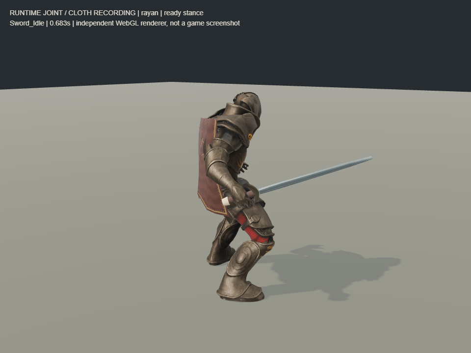
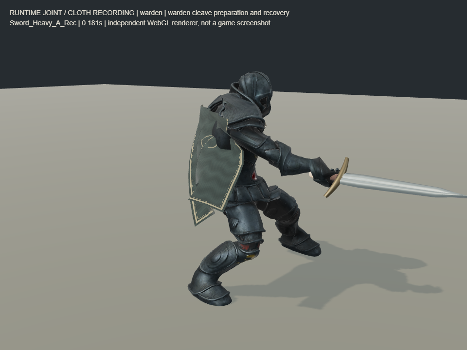

# Armored trial revision — 0.7.0-rc.1

The screenshot supplied during this revision showed the original campaign village. Its primitive figures, repeated scenery and flat material treatment do not resemble God of War, Black Myth: Wukong or Elden Ring. More procedural armor on the previous ranger figures also failed that target. This revision replaces the trial's character foundation and makes the current encounter the unambiguous Play option. The earlier campaign remains in a clearly labeled prototype archive with its saves intact.

## Character and motion changes

- **Knight by piacenti**, CC BY 3.0, replaces both ranger figures. It has artist-authored plate geometry and 2048-pixel color, normal, metallic and roughness maps. The two fighters share this base model with warm/cold steel palettes, different scale and distinct simulated mantles; these are not two independently authored character models.
- The source was unrigged. The new reproducible Blender pipeline removes the shield, fits 65 bones, assigns anatomical skin weights, preserves rigid plate zones, and converts the A pose to a T bind pose. Forty-five existing authored CC0 clips are retargeted to those proportions. These clips are not newly captured motion capture.
- The first light attack uses the shorter authored cut. Warden cleaves and finishers have moving anticipation, with root movement and damage windows driven by the same remapped animation clock. A forward sprint plus heavy attack performs a committed advancing cut; the second-phase Warden uses its own range/corridor-limited advancing attack.
- Upper-body target-height gaze, hand-prop attachment updates, curved sword guard/grip/fullered blade, and bounded optional camera impact response supplement the existing inertial transitions, interpolated bones and foot correction.
- Original mantles have woven trim, a broken vow seal, different hems and shoulder collision capsules. A ruined cloister and fitted radial masonry frame the courtyard outside the combat space. Material and ambient-light levels are restrained.
- The main menu displays the build version and provides artist credits. The old campaign's ambiguous “Begin a new journey” entry has moved into the prototype archive.

The preceding gameplay pass adds composure breaks and physical ripostes, authored enemy pattern families and recovery, defensive input buffering, guard rearming, obstacle-aware spacing, round statistics, camera/input fixes and clearer encounter instructions.

## Reference inspection

Official references were inspected as reference material only; no franchise assets or source code were copied into the game:

- [God of War Ragnarök combat guide](https://www.playstation.com/en-us/games/god-of-war-ragnarok/god-of-war-combat-refresher-course/), including its publicly available attack video. Two YouTube videos required age-verified sign-in and were not accessed through user accounts. The official costume/art guide was also consulted.
- [Black Myth: Wukong gameplay](https://www.youtube.com/watch?v=VUlzltBX3Ac) and [PlayStation gallery](https://www.playstation.com/en-us/games/black-myth-wukong/). Selected footage frames were examined for poses, cloth/armor layers and attack presentation.
- [Elden Ring official gameplay preview](https://www.youtube.com/watch?v=JldMvQMO_5U) and [official image gallery](https://www.eldenring.jp/movieandimages.html). Selected footage frames informed silhouette, palette and environmental scale.
- [Ozz animation](https://github.com/guillaumeblanc/ozz-animation), including its MIT license and look-at sample, was read for joint-local correction and chain weighting. [Motion-Matching](https://github.com/orangeduck/Motion-Matching) and its MIT license were reviewed as another public reference. Neither codebase nor dataset was incorporated; this game does not claim to implement motion matching.

Reference videos and images remain in the ignored authoring cache. They are not distributed with the game.

Additional selected frames were inspected from the public God of War attack clip at 1.5, 1.8 and 2.1 seconds; Wukong footage at 44.8, 45.2 and 45.6 seconds; and Elden Ring exploration, costume and boss-combat footage at 8:00, 10:00, 13:00, 17:00 and 18:30. This is frame inspection, not a claim that every minute of each video was watched.

The comparison still exposes specific gaps:

| Area | What the references show | Current trial limit |
|---|---|---|
| Character identity | Distinct body shapes, layered costume construction, hair/fur and material response | A shared armored body with two treatments; no bespoke face or hair production |
| Combat motion | Large changes of support, body rotation, strong follow-through and opponent reactions designed for each move | Retargeted clips and synchronized physical contacts; limited reaction variety and no paired performance |
| Setting | Irregular stonework, ground debris, vegetation and foreground/background layers arranged around the encounter | A deliberately small courtyard; more repetitive geometry and unverified native lighting |
| Presentation | Character, opponent, effects and camera composed together in actual gameplay | Isolated asset review and headless logic checks; a rendered comparison is still required |

## Rebuilding the character assets

Normal setup/build uses committed assets. Blender is needed only to reproduce the art conversion. Python authoring also uses NumPy and Pillow. Obtain Blender from its official distribution and verify its published checksum.

```powershell
python .\tools\fetch_knight_asset.py
# Replace the executable path with your verified Blender installation.
& 'C:\Tools\Blender\blender.exe' --background --factory-startup --disable-autoexec --python-exit-code 1 .\tools\cache\duel-reference\armor.blend --python .\tools\compile_knight.py
python .\tools\optimize_knight_assets.py
& .\tools\engine\Godot_v4.7.2-stable_win64_console.exe --headless --path game --editor --import --quit
& .\tools\engine\Godot_v4.7.2-stable_win64_console.exe --headless --path game --script res://tests/bake_performance.gd
& .\tools\engine\Godot_v4.7.2-stable_win64_console.exe --headless --path game --script res://tests/bake_gait_phases.gd
```

The fetcher pins the source SHA-256 and extracts only `armor.blend`. Embedded scripts are disabled. Only the armor mesh and its four maps are selected; the source's unrelated packed sample photograph is excluded. Lossless PNG compression and shared external maps avoid duplicate textures. About 77 MB of unused ranger maps were removed. Provenance and modifications are recorded in `game/assets/performance/knight_provenance.json` and `KNIGHT_LICENSE.txt`; the complete attribution also accompanies the portable executable.

## Audit fixes

- Losing the ground ray now releases the foot's planted state and its old anchor together. Previously, reacquiring the ground could index an anchor that no longer existed.
- Combat resource and contact checks reject non-finite, negative, zero-damage and future-time inputs as appropriate. Save validation requires whole-number inventory/progression fields, bounded lists and unique IDs, and checks the serialized size before writing a temporary file.
- Settings have a 64 KiB read limit and strict scalar/type/range validation. The reader preserves the generated INI format without passing writable settings text through Godot's general object-capable Variant parser. This is local input hardening, not a claim of a demonstrated remote exploit.
- Release packaging verifies the clean source commit, runtime fingerprint, executable hash and a completed campaign/source test record. An old successful report or executable can no longer stand in for the current candidate.
- Build tools now check for Python 3.11 or newer before expensive work; this is the minimum for the `hashlib.file_digest` calls they use. Supported, unsupported and failed-interpreter paths were checked. The site guide now names the current trial/archive menu entries and correctly distinguishes credited trial assets from original campaign art.

## Validation status and limits

The tested runtime is commit `db5951e72a0dab2f1be482ba6dc521d3a4b7b900`, version `0.7.0-rc.1`, with runtime SHA-256 `5554295e15c65469375db9520e1eaa82b03a4135960f0041fb197ac3093c229d`. Later evidence, documentation, build-tool and independent-viewer corrections do not change those runtime bytes.

- **556 headless assertions** passed, plus complete campaign traversal, relaunch/Continue and transition exit/recovery checks. The six trial, motion, physical-combat, duel, presentation and audit suites also passed at 30 physics ticks.
- **15 checks of a fresh portable ZIP extraction** passed: quality, campaign/Continue, and those six suites at both 30 and 60 physics ticks. This uses the packaged executable without the editor or a project path.
- A fresh source ZIP imported without any prior `.godot` cache, passed trial/presentation/audit checks, and produced the same runtime fingerprint.
- Rebuilding from the checksum-pinned Knight archive in a separate directory reproduced both GLBs and all three shared texture files byte for byte.
- Release identity fixtures accepted a matching candidate and rejected six stale or incomplete variants. The existing seven site/browser checks also passed after updating credits.
- The independent asset viewer sampled skinned mesh bounds at three points in each of the 45 clips (135 poses); representative backward/side locomotion, turns, reactions and death poses were visually inspected. `npm audit` reported zero known advisories for the QA tool dependencies on this date; these dependencies are not shipped in the game executable.
- The frozen real-time endurance run completed **3,600.034 seconds** with **zero failures**, 29 scripted rematches, 8,242 action requests, 25,296 actor pose samples, 10,833 second-phase samples and 177 sampled advancing swings. Node count stayed at 313 in every minute report. The source manifest still matched the final game files exactly. Health/stamina refills make this a stress fixture, not a balance or human-input playtest.

The unsigned local candidate is in `exports/releases/v0.7.0-rc.1-delivery`; it has not been published as a GitHub release. [Machine-readable results and source logs](evidence/armored-trial/) accompany this document. The package's embedded build identity refers to the tested runtime commit above, not a later documentation/tooling commit.

The [session record](evidence/armored-trial/session.json) records the requested work periods in UTC: gameplay work from 07:48:23 to 08:50:32, visual/reference work from 08:50:32 to 10:03:34, and the subsequent audit through 11:17:19 on 2026-11-17. The final endurance run lasted from 10:16:43 to 11:16:44. An earlier short audit run was deliberately terminated to include the final settings parser; it is not counted as a completed soak. [Final validation summary](evidence/armored-trial/validation-summary.json).

All Godot execution was headless. Blender used background mode with automatic script execution disabled. Separate hidden WebGL viewers inspected the imported poses and actual recorded runtime joints/cloth across 19 action segments per fighter. A static courtyard export was also inspected. These use independent lighting, and their images are explicitly labeled **not game screenshots**. They do not verify Godot's rendered materials, sustained GPU frame rate, human input feel, physical controller behavior or audio listening.

This is still below the requested AAA visual/animation level. It is a more detailed armored duel with a stronger asset foundation, not evidence of parity with those games. Native rendered acceptance remains outstanding under the user's restriction against opening the game on this Remote Desktop.

## Isolated asset previews

These are independent WebGL inspections, **not screenshots of the running game**. Rayan and the Warden use the same credited base model with different palette, scale and mantle. The courtyard view uses independent lighting and does not reproduce Godot's sky, material projection, post-processing or complete combat presentation.





[Static courtyard inspection](evidence/armored-trial/court-static.png). Armor: [Knight by piacenti, CC BY 3.0](https://opengameart.org/content/knight-2), modified as described above; authored motion and rig reference: Quaternius / Gonzalo Furnier, CC0. Original mantle and weapon geometry: ASHEN VOW.
