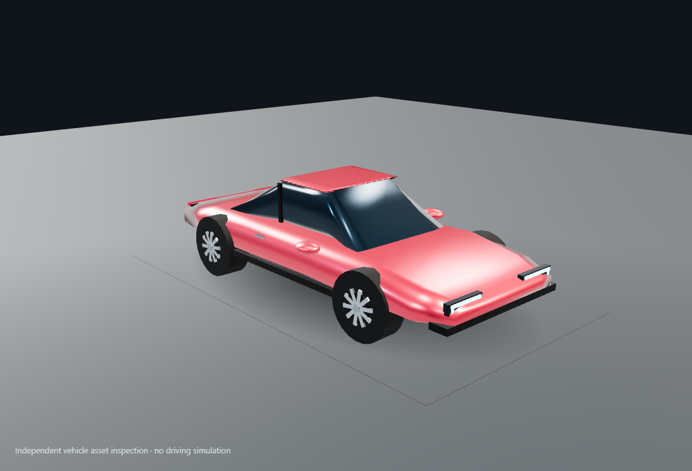
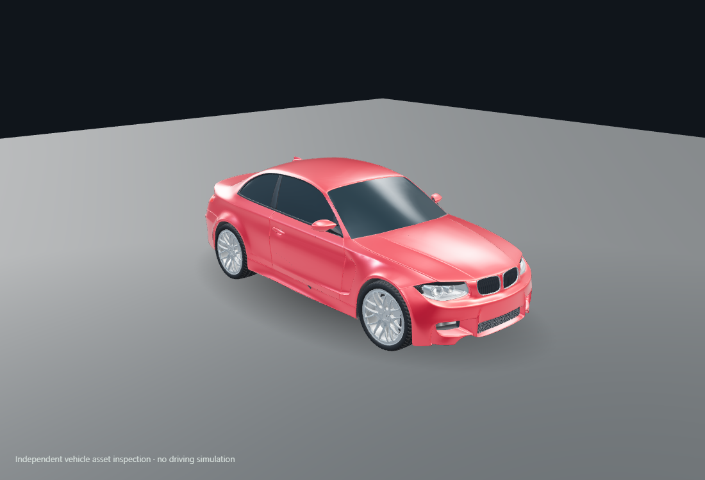
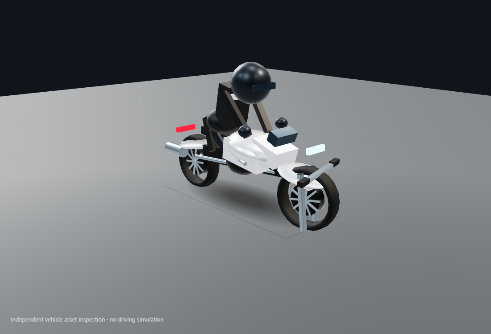
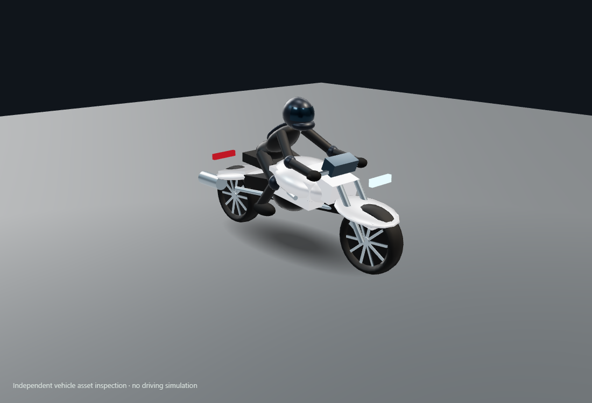

# NIGHTSHIFT 1.1.0 candidate

This branch begins from the existing racing game on `main`. ASHEN VOW remains on `ashen-vow`, and `main` has not been changed.

## Visible changes and their scope

The two touring cars now use an adapted Mike Pan model with a detailed body, wheels, lamps, grille and interior silhouettes. This is a credited third-party asset under CC BY-SA 3.0, not a model originally created for NIGHTSHIFT. The runtime conversion uses eight material groups, fixed brake calipers and four steering/rolling assemblies. At distance, the car drops from 135,534 to 33,343 rendered triangles in the isolated contract scene. Both representations follow the same suspension pose, with hysteresis to reduce repeated switching near the threshold.

The following images are **isolated software asset inspections**, not in-game captures or a demonstration of native GPU performance. The earlier image and new image use the same inspection environment.

| Earlier touring car | Updated touring car |
|---|---|
|  |  |

Motorcycle riders now have connected, better proportioned body segments and helmets. Their hands follow the actual steering assembly; the body shifts into a turn and tucks with speed/boost. Forks connect to the axle instead of extending below the tire, and tire radius matches the contact plane. These riders remain procedural models, not scanned or artist-sculpted characters.

| Earlier rider | Updated rider |
|---|---|
|  |  |

The new car inspection image is distributed with the same CC BY-SA 3.0 attribution as the adapted model: **BMW 1 Series M In Cycles by Mike Pan**, adapted for NIGHTSHIFT. See [attribution and license](../public/assets/touring/LICENSE.txt). Other fleet members and the environments retain their existing procedural foundation. This revision does not establish AAA production quality.

## Motion and resource changes

Driving runs at a fixed 60 Hz, independently of the render cap. Moving roots are interpolated, steering is analog and damped, drift uses a separate travel vector, and releasing the handbrake recovers grip gradually. Car bodies respond with suspension pitch/roll; a critically damped chase camera and optional reduced-motion mode replace frame-dependent camera easing. Traffic carries excess distance through road segments and uses continuous lane offsets/headings. Remote vehicles take the short angular path across the ±180° seam.

Battery saver is the fresh-profile default. All quality modes have absolute pixel and height limits, so a large high-DPI display cannot silently multiply the intended rendering cost. The garage settles and renders again on manipulation/resize, paused races stop requesting frames, hidden windows pause, and inactive audio suspends its processing graph. Decorative menu animation stops in Battery saver. Particle and tire-mark storage is fixed at 96 particles and 384 trail segments, respectively. These constraints reduce work; no temperature, power or target-laptop FPS result is claimed.

## Correctness and LAN fixes

The relay now rejects malformed/scalar input safely, limits payloads, message rates and queued output, validates finite position data and allowed identities, rejects unrelated browser origins, limits room size and transfers host ownership. Only the host can start a race, and clients wait for the server acknowledgement. Full lobbies, cancelled joins and disconnected sessions resolve cleanly. Local-only binding is the default; LAN access is explicit. This remains a casual relay, not an authoritative anti-cheat service.

The client safely handles blocked/full browser storage. Driver names and vehicle labels are escaped, CSS colors are constrained, and startup errors use text content. Touch release no longer masks a held physical key. Audio effects, actor cleanup, particle storage, tire marks and repeated race teardown have bounded lifetime checks. Previously tracked browser profiles and generated bundles were removed from this branch's index and ignored; local copies and Git history are preserved.

## Evidence

- 21 unit/integration tests cover render-rate-independent dynamics, long stalls, springs, pixel budgets, drift recovery, traffic continuity, particle/trail lifetime, storage, markup escaping and the LAN protocol.
- Headless browser smoke covers all four maps, all 26 vehicles, repeated race teardown, 30 FPS presentation bounds, a settled garage, suspended pause/audio, reduced-motion persistence, mixed keyboard/touch input, multi-touch and focus loss.
- Asset contracts exercise 180 animation samples for each vehicle, verify finite transforms, rider-hand attachment, matching suspension across detail levels, lower distant triangle counts, and particle/trail shader compilation.
- Four browser WebSocket clients verify synchronized start, full-lobby rejection, host transfer and cancelled connection handling.
- The production bundle boots with its packaged car assets, starts a race, pauses/returns to the menu, includes credits, omits development control hooks, and remains usable when local storage is blocked.
- Blender 4.5.16 reproduces the car, distance model and rig metadata byte-for-byte from the pinned source. Logs and hashes are under [evidence/revision-1.1](evidence/revision-1.1).

The real-time frozen endurance report is added when complete. Browser checks use headless Chromium and software rendering; no graphical game window or desktop input was used. Physical controllers, native graphics, audio listening, temperature and subjective driving acceptance remain untested.
